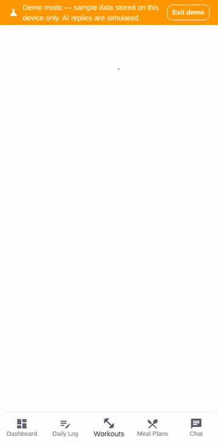
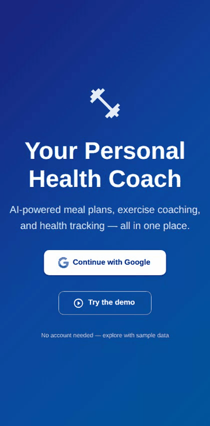
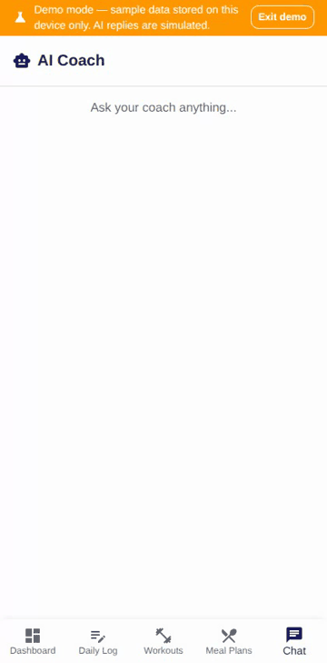
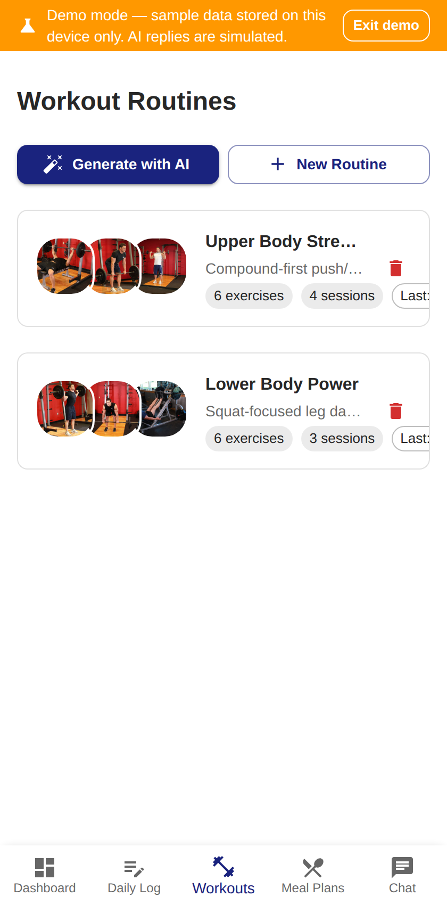
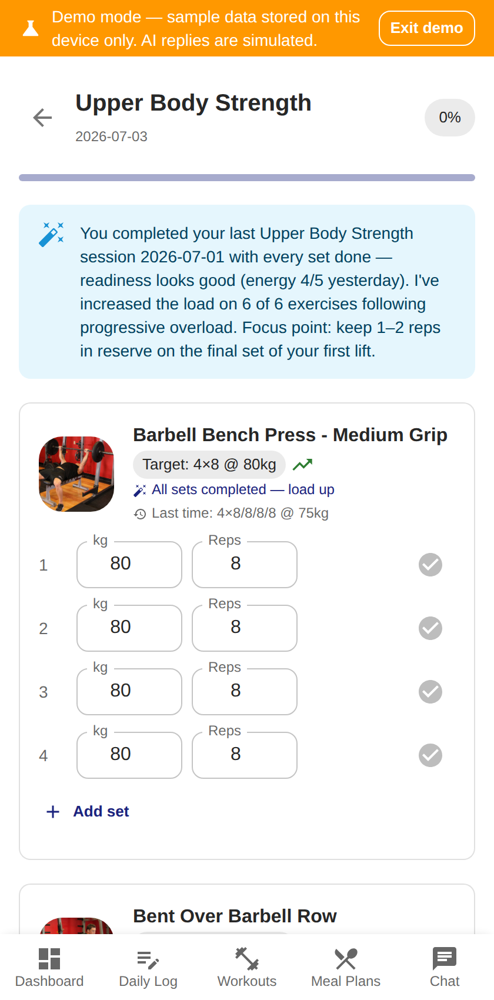
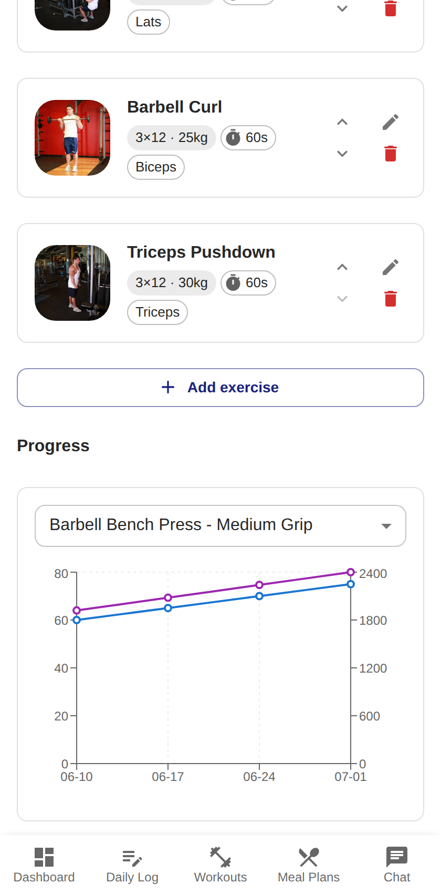
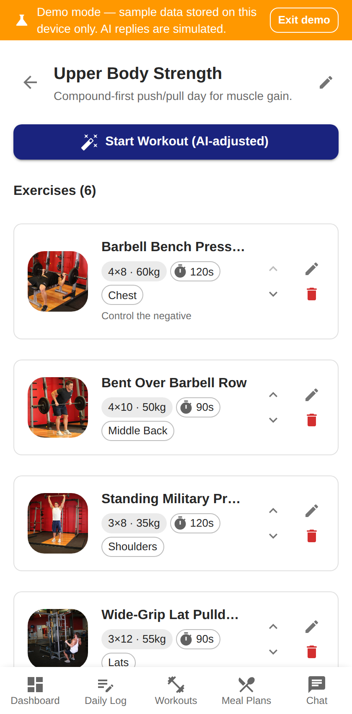
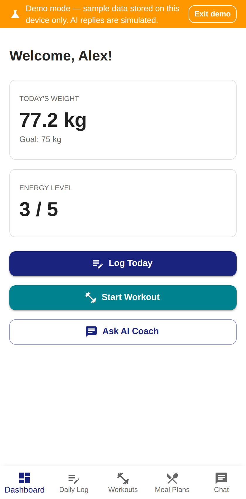
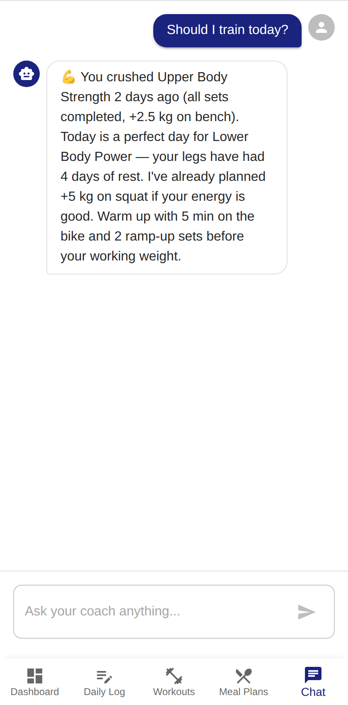

<div align="center">

# 🏋️ Training AI Coach

**Your personal AI health coach — workouts that adapt to you, meal plans that understand you.**

[**🌐 Live App**](https://ai-training-coach-6880b.web.app) · **▶️ Try the Demo** (no account needed — one click on the landing page)


<br/>

*Start a session and the AI adjusts your weights for the day. Log set by set. Watch the progression.*



</div>

---

## ✨ What it does

Training AI Coach is a **serverless, mobile-first web app** that combines a multi-agent Gemini backend (LangGraph) with structured health tracking:

- 🏋️ **Workout routines with animated exercise demos** — build routines from a searchable library of **870+ exercises with demo images**, or let the AI generate one from your profile (goal, equipment, session length). Custom GIF URLs supported per exercise.
- 🤖 **AI session planning (progressive overload)** — every time you start a workout, the AI looks at your recent sessions and daily readiness (energy, weight, notes) and adjusts **weight, reps, and sets per exercise**, with a coaching insight for the day.
- 📈 **Per-routine progress tracking** — log every set (weight × reps) with autosave, see *last time* numbers next to today's targets, and charts of top-set weight and volume per exercise. If a lift hasn't moved in **2+ weeks**, the AI flags the plateau and changes strategy (deload, new rep scheme, or a variation).
- 📰 **Weekly AI report** — when you open the app and your last report is a week old (or on demand), the coach summarizes your week: sessions, total volume vs. last week, weight trend, energy, wins, and what to focus on next.
- 🎯 **Goal forecast** — a regression over your recent weigh-ins projects when you'll hit your goal weight ("at this rate: ~August 15") and warns when your weight stalls or trends the wrong way.
- 🍽️ **Meal plan intelligence** — upload a PDF/DOC/image meal plan (English or Spanish); Gemini extracts meals, macros, and rules, and the diet agent answers with your plan as context.
- ⚖️ **Body composition parsing** — screenshot from Fitdays/InBody/Tanita/Withings or an ISAK anthropometry report → structured data + AI summary.
- 💬 **Multi-agent chat** — a LangGraph router sends each message to a diet, exercise, health, or general coach agent, all enriched with your profile, active meal plan, and last 7 days of logs.
- 🌍 **Fully bilingual** — English & Spanish UI and AI responses.

---

## 🧪 Demo mode

Click **“Try the demo”** on the landing page — no Google account, no Firebase setup, no API key.

Demo mode runs the **entire app offline**: a seeded local database (profile, 4 weeks of logs, two routines with training history) lives in `localStorage`, and AI calls are answered locally — the session planner even computes **real progressive overload** from the sample history, so the demo behaves like the live coach. A banner reminds you it's simulated; exit any time.

| Landing → Demo | AI routine generation | Chat with context |
|:---:|:---:|:---:|
|  |  |  |

---

## 📸 Screenshots

| Routines | Session (AI-adjusted) | Progress charts |
|:---:|:---:|:---:|
|  |  |  |

| Routine detail | Dashboard | AI answer |
|:---:|:---:|:---:|
|  |  |  |

---

## 🏗️ Architecture

```
Browser (React 19 + Vite + MUI v7)
        │
        │  demo mode? ──► local demo DB (localStorage) + simulated AI
        │
        │  Firebase SDK (Auth · Firestore · Storage · httpsCallable)
        ▼
Firebase Cloud Functions (Python 3.12)
        │
        ├── chat()
        │      └── LangGraph StateGraph
        │              ├── router      (gemini-2.0-flash — classifies intent)
        │              ├── diet        (gemini-2.0-flash)
        │              ├── exercise    (gemini-2.0-flash)
        │              ├── health      (gemini-2.5-pro)
        │              └── general     (gemini-2.0-flash)
        │
        ├── generate_routine()              — AI designs a routine from the user profile
        ├── plan_workout_session()          — progressive-overload targets from history + readiness
        ├── parse_exercise_photo()          — Gemini vision → structured exercise list
        ├── parse_body_composition_report() — Gemini vision → full BIA/anthropometric data
        └── extract_meal_plan_content()     — Gemini vision → structured nutrition data

Exercise demos: yuhonas/free-exercise-db (public domain, 870+ exercises)
— two photo frames per exercise, animated client-side like a GIF.
```

### Context injected into every chat

```
User Profile          name · age · goals · diet · equipment · restrictions · tone · language
Active Meal Plan      calories · macros · full meal breakdown
Recent 7-day Logs     weight · energy · notes · measurements · BIA report · exercise log
```

### How AI session planning works

1. You tap **Start Workout** on a routine.
2. The client sends the routine template + your last 4 completed sessions.
3. The function loads your profile and last 7 days of readiness logs (energy 1–5, weight, notes).
4. Gemini applies progressive overload rules — completed all sets → load up (~2.5% upper / ~5% lower body); missed reps → hold; low energy or “sore/tired” notes → deload — and returns per-exercise targets with a one-line reason each, plus a daily coaching insight.
5. Finished sessions are mirrored into the daily log, so the chat agents know what you trained.

---

## 🗃️ Data model (Firestore)

```
user_status/{uid}                     approval workflow (pending/approved/rejected)
users/{uid}/profile/data              full preference profile
users/{uid}/logs/{YYYY-MM-DD}         weight · energy · measurements · BIA · food/exercise logs
users/{uid}/meal_plans/{planId}       uploaded plan + extracted nutrition structure
users/{uid}/routines/{routineId}      { name, description, exercises: [{ name, muscle_group,
                                        sets, reps, weight_kg, rest_sec, images[], gif_url }] }
users/{uid}/workout_sessions/{id}     { routine_id, date, status, ai_insight, total_volume_kg,
                                        exercises: [{ target_*, change, ai_note, last_summary,
                                        sets: [{ reps, weight_kg, done }] }] }
users/{uid}/chat_sessions/{sessionId} chat history
```

---

## ☁️ Cloud Functions

| Function | Description |
|---|---|
| `chat` | LangGraph multi-agent chat with profile + meal plan + 7-day log context |
| `generate_routine` | Designs a 5–8 exercise routine from the user profile and an optional focus |
| `plan_workout_session` | AI-adjusted targets for today's session (progressive overload + readiness) |
| `parse_exercise_photo` | Gemini vision reads whiteboard/notes photos into structured exercises |
| `parse_body_composition_report` | Extracts BIA & ISAK/anthropometric report data |
| `extract_meal_plan_content` | Extracts structured nutrition data from meal plan documents |

---

## 📂 Project structure

```
├── firebase.json · firestore.rules · firestore.indexes.json · storage.rules
│
├── functions/                     # Python Cloud Functions
│   ├── main.py                    # chat · generate_routine · plan_workout_session · parsers
│   ├── agents/coordinator.py      # LangGraph StateGraph
│   └── lib/context.py             # Builds AI context from Firestore data
│
└── web/src/
    ├── demo/                      # 🧪 demo mode: seed data · local DB · simulated AI
    ├── firebase/                  # config · auth · firestore · storage · callables
    ├── lib/                       # exerciseLibrary (870+ demos) · workout stats
    ├── components/
    │   ├── ExerciseGif.tsx        # animated exercise demo (frames or GIF url)
    │   └── routines/              # exercise picker + config dialogs
    ├── pages/
    │   ├── RoutinesPage.tsx       # list · create · AI generate
    │   ├── RoutineDetailPage.tsx  # edit · history · progress charts · start session
    │   ├── WorkoutSessionPage.tsx # AI insight · set-by-set tracking · finish
    │   ├── DashboardPage · ChatPage · MealPlansPage · LogPage (+ tabs)
    │   └── onboarding/            # 5-step wizard
    ├── store/                     # Zustand (auth · profile · chat)
    └── i18n/locales/              # en.json · es.json
```

---

## 🚀 Getting started

### Instant demo (no backend, no config)

```bash
cd web && npm install && npm run dev
```

Open http://localhost:5173 and click **Try the demo**. Everything — routines, AI session planning, weekly report, chat — works offline with sample data. No Firebase project, `.env.local`, or Gemini key required.

### 🧪 E2E tests (Playwright)

```bash
cd web && npx playwright install chromium   # first time only
npx playwright test
```

16 end-to-end tests drive the app through demo mode like a real user — entering the demo, seeded dashboard, goal forecast, auto-generated weekly report, routine create/edit/delete, AI routine generation, an AI-planned workout session logged set by set and mirrored into the daily log, chat with context, and exiting the demo. No backend needed.

### Full deployment

<details>
<summary>Prerequisites & steps</summary>

**Prerequisites**

- Node.js 18+ · Python 3.12 · Firebase CLI (`npm i -g firebase-tools`)
- A Firebase project with Auth (Google), Firestore, Storage, Hosting, and Functions
- A Gemini API key

**1. Install**

```bash
cd web && npm install && cd ..
cd functions && python -m venv venv && venv/bin/pip install -r requirements.txt && cd ..
```

**2. Configure `web/.env.local`** with your real Firebase web-app config, plus:

```env
VITE_ADMIN_UID=<your Firebase Auth UID>
```

**3. Secrets & config**

```bash
firebase secrets:set GEMINI_API_KEY
```

Set your storage bucket name in `firebase.json`, and your admin UID in `firestore.rules`.

**4. Deploy** (includes the Firestore composite index for workout history)

```bash
npm run build --prefix web
firebase deploy
```

</details>

---

## 🔒 Security

- All Firestore reads/writes under `users/{uid}` are restricted to the authenticated owner.
- New accounts require **admin approval** before accessing the app (real-time status updates).
- The Gemini API key is a Firebase Secret — never shipped to the client.
- Demo mode stores its sample data **only in the browser's `localStorage`** and makes no backend calls.

---

## 🙏 Credits

- Exercise demo images & metadata: [yuhonas/free-exercise-db](https://github.com/yuhonas/free-exercise-db) (public domain)

## License

MIT
